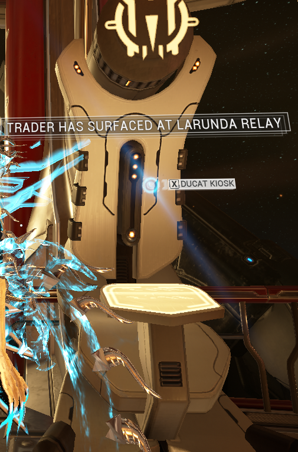

# Why run relics?

Imagine this situation: you are a fairly new player, making progress through the Origin system, and you stumble upon your first few relics. Now, you might be wondering,

<em><strong>Why would I run these relics instead of selling them?</strong></em>

There are mainly 2 reasons as to why people run relics: **Ducats** and **Platinum**.

### Ducats

Ducats are a necessary currency when trading with Baro Ki’teer, the Void trader. He won’t accept Platinum, but Ducats instead, and you can only obtain them while selling your Prime parts in the kiosks located in all relays.

Prime parts come in batches of 15, 25, 45, 65 and 100 Ducats, and, usually, that amount reflects on their Platinum price (for example, a 100 Ducats part is usually more expensive than a 15 one)

While you can sell any Prime part for Ducats, it is recommended not to sell all you obtain, since some of them are best suited to be sold for Platinum instead. There are several tools, like warframe.market’s [**Ducanator**](https://warframe.market/tools/ducats) that helps you choose which parts to sell for Ducats.

### Platinum

Platinum is essentially the premium currency of the game, and DE gives us many options to sell various items for Platinum.

One of them is, as this guide focuses on, Prime parts. Just like with Ducats, not all parts are really worth to be sold for Platinum, but it also depends on your budget and how easily you can make profit. At the end of the day, you have to be smart and know what, when and who to sell.

